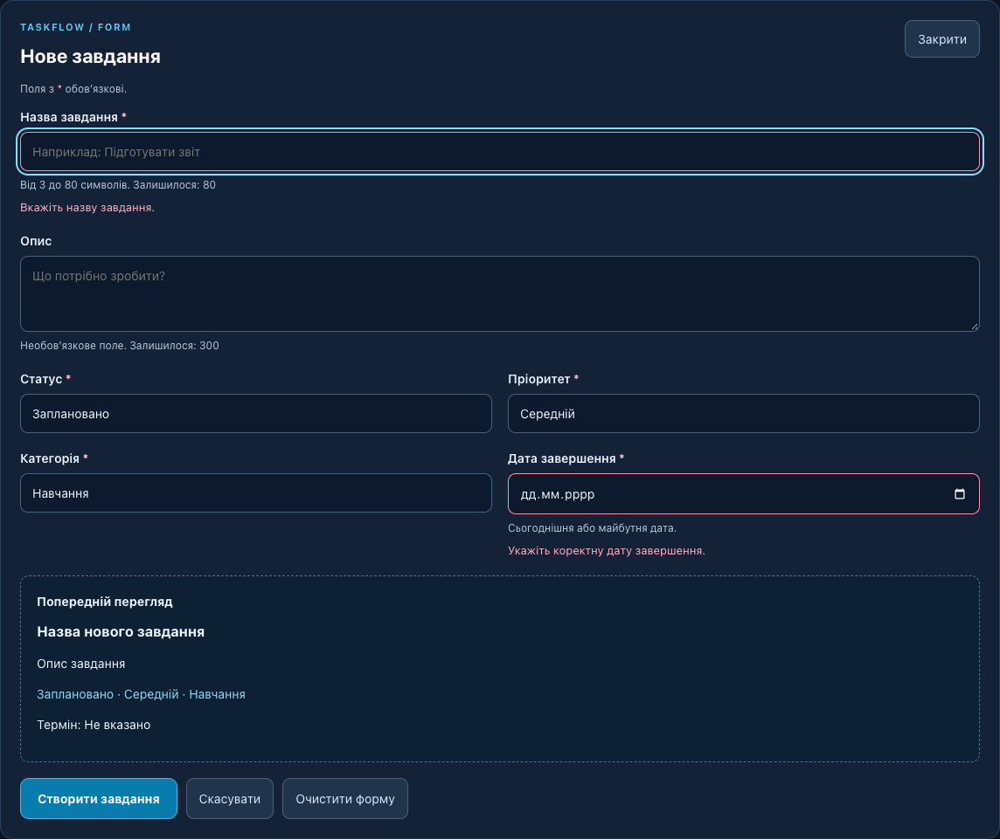
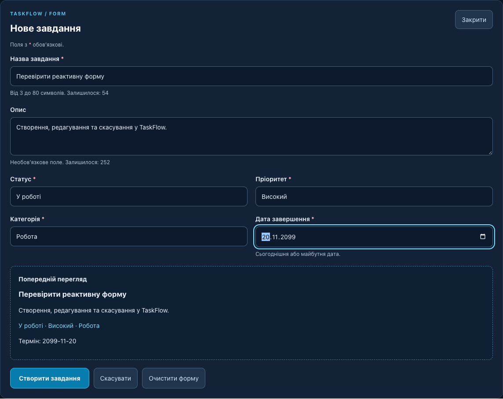
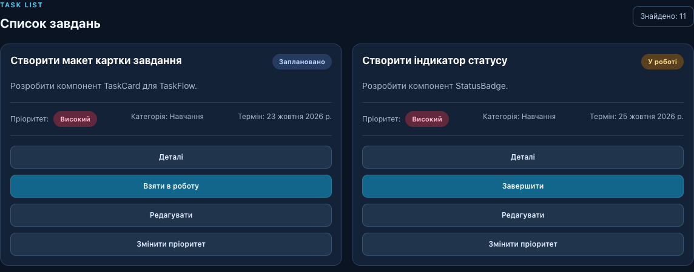
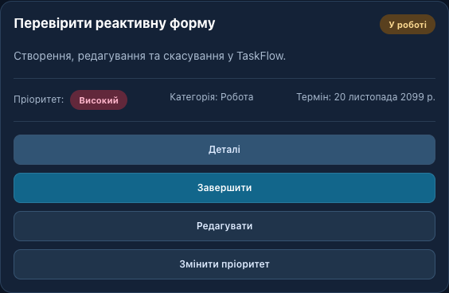
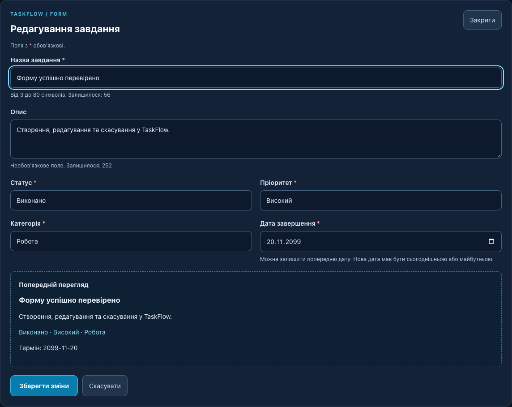
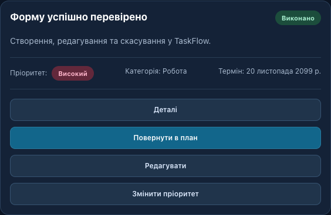
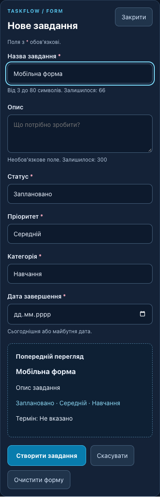

# Звіт з практичної роботи № 4

TaskFlow • Реактивні форми, створення та редагування завдань

Дата виконання: 06.11.2026. Основа: методичні вказівки «2-6.pdf».

## 1. Тема та мета

Тема: форми користувача, v-model, реактивний стан, перевірка введення, створення та редагування завдань у Vue 3. Мета: навчитися працювати з реактивними полями, передавати результати через Props та Emits і оновлювати спільне сховище TaskFlow.

## 2. Теоретичні відомості

<b>ref()</b> створює реактивне значення; у JavaScript доступ здійснюється через .value. <b>reactive()</b> повертає реактивний об’єкт, зміни полів якого оновлюють інтерфейс. <b>computed()</b> обчислює та кешує похідні значення, зокрема помилки, фільтри та статистику.

<b>v-model</b> пов’язує input, textarea або select із полем стану в обох напрямках. Модифікатор <b>.trim</b> прибирає крайні пробіли. <b>@submit.prevent</b> обробляє надсилання без перезавантаження сторінки, а novalidate дозволяє показувати власні повідомлення українською.

<b>Props</b> передають вихідне завдання до форми. Форма редагує локальну копію та через <b>Emits</b> повідомляє про save або cancel. Валідація перевіряє дані перед збереженням; однакові правила застосовуються у формі та сховищі.

## 3. Підсумок виконання

Реалізовано всі основні кроки та 7 додаткових завдань. Збережено попередні фільтри, сортування, деталі, картки та статистику. Дані існують у пам’яті поточного сеансу. У цьому проєкті 10 початкових записів, тому T8 відновлює 10, а не 6 із прикладу методички.

## 4. Структура та призначення коду

```js
src/
  components/TaskForm.vue       # новий компонент
  components/TaskCard.vue       # editable, edit, категорія
  store/tasks.js               # валідація, addTask, updateTask
  pages/TasksPage.vue           # відкриття форми, saveTask, пошук
  pages/HelpPage.vue            # оновлена довідка
  css/task-form.css            # нові стилі
  data/tasks.js                # 10 початкових записів
reports/practice4/              # перевірки та скріншоти
output/pdf/TaskFlow_forms_report.pdf
```

<b>TaskForm.vue</b> отримує task або null, створює локальний reactive-об’єкт, показує лічильники символів, помилки та попередній перегляд. Ключ editingId або new створює окремий екземпляр форми при перемиканні записів.

<b>addTask()</b> повторно перевіряє дані, прибирає крайні пробіли, обчислює ID як max поточних ID + 1 і додає запис. <b>updateTask()</b> знаходить запис за ID та застосовує перевірені значення через Object.assign, зберігаючи ID.

<b>submitForm()</b> вмикає помилки, фокусує перше некоректне поле або генерує save. <b>saveTask()</b> обирає addTask чи updateTask, закриває форму після успіху, показує підтвердження та скидає фільтри й пошук.

## 5. Приклади двостороннього зв’язування

```js
const form = reactive({ ...defaults(), ...props.task })
const errors = computed(() => validateTaskData(form, props.task))

<input v-model.trim="form.title" />
<form novalidate @submit.prevent="submitForm">

if (Object.keys(errors.value).length) return
emit('save', { title: form.title.trim(), /* інші поля */ })

<TaskForm :key="editingId ?? 'new'" :task="editingTask"
  @save="saveTask" @cancel="cancelForm" />
```

## 6. Порожня форма та повідомлення про помилки

Після натискання «Створити завдання» без введення даних показано помилки назви й дати. Стандартні статус, пріоритет і категорія вже коректні. Новий запис не додається, фокус переходить до назви.



Правила: назва 3-80 символів; опис до 300; статус і пріоритет із дозволених списків; коректна календарна дата. Для нових записів додатково перевіряються унікальність назви та дата не в минулому.

## 7. Заповнена форма та попередній перегляд

Введено назву, опис, статус «У роботі», пріоритет «Високий», категорію «Робота» та майбутню дату. Попередній перегляд і кількість доступних символів змінюються під час введення.



Для відтворюваної перевірки використано 20.11.2099. Інтерфейс приймає також сьогоднішню дату та інші майбутні дати за локальним календарем браузера.

## 8. Список до та після додавання

Початково список містить 10 записів. Після збереження форми створено завдання з ID 11; кількість збільшилася до 11. Фільтри повернуто до «Усі», щоб новий запис був доступний.






## 9. Редагування наявного завдання

Через кнопку «Редагувати» відкрито локальну копію запису № 11. Назву змінено на «Форму успішно перевірено», статус - на «Виконано». Після збереження оновлюється той самий запис.



До збереження зміни не потрапляють до картки. Початкова прострочена дата старого запису дозволена, якщо її залишити без змін. Якщо дату замінюють, нова має бути сьогоднішньою або майбутньою.

## 10. Результат редагування та скасування



Після повторного відкриття форми введено назву «Цю зміну треба скасувати» та натиснуто «Скасувати». Картка зберегла попередні дані; додатковий запис не створено.


Сховище окремо перевірено на збереження ID, відхилення некоректного оновлення без часткових змін та незмінність об’єктів із початкового модуля даних.

## 11. Результати тестування T1-T8

- T1: Порожня форма: помилки назви й дати; залишилося 10 записів. Результат: успішно.

- T2: Назва з 2 символів відхилена; показано мінімум 3. Результат: успішно.

- T3: Створено нову картку: 10 → 11, категорія «Робота», статус «У роботі». Результат: успішно.

- T4: Назву й статус картки змінено; кількість 11. Збереження ID окремо підтверджено тестом сховища. Результат: успішно.

- T5: Після скасування збережено назву «Форму успішно перевірено». Результат: успішно.

- T6: Створення одразу зі статусом «Виконано»: усього 12, виконано 5 (42%). Після попереднього редагування було 11/4. Результат: успішно.

- T7: Після створення скинуто обидва фільтри й пошук; видно всі 13 карток. Результат: успішно.

- T8: Після reload відновлено 10 записів із src/data/tasks.js (у методичці приклад на 6). Результат: успішно.

Перевірено у Chrome через Playwright. Runtime-помилок не виявлено. Додаткові сценарії: дубль без урахування регістру, минула дата, незмінена стара дата, очищення, пошук та ширина 390 px без горизонтального переповнення. Результати: reports/practice4/verification.json і store-verification.json.

<b>npm run build</b>: успішно. Сформовано production bundle, manifest і service worker. Є попередження Vite про JS-пакет понад 500 kB; збірка не блокується. Повний лог: reports/practice4/build.log. Встановлення PWA та офлайн-запуск на фізичному пристрої окремо не перевірялися.

## 12. Додаткові завдання та адаптивність

1. <b>Категорія:</b> навчання, робота, особисте; показано у формі, перегляді та картці. Для початкових записів без цього поля відображається «Навчання».

2. <b>Дата:</b> нове завдання не може мати минулу дату; стару можна залишити незміненою при редагуванні. Перевірка діє й у сховищі.

3. <b>Символи:</b> показано залишок до 80 для назви й до 300 для опису.

4. <b>Очищення:</b> кнопка повертає стандартні значення у режимі створення та прибирає повідомлення про помилки.

5. <b>Доступність:</b> зірочки, required, підписи label, aria-invalid, aria-describedby, фокус першого помилкового поля, видимі фокусні контури та aria-live для перегляду.

6. <b>Пошук:</b> фільтрує назви під час введення, без урахування регістру, разом із попередніми фільтрами й сортуванням.

7. <b>Унікальність:</b> нова назва перевіряється після trim без урахування регістру. При редагуванні перевірка унікальності не застосовується, відповідно до додаткового завдання.



## 13. Висновок

Розширено TaskFlow універсальною реактивною формою створення й редагування. Закріплено v-model, reactive, ref, computed, Props та Emits. Дані перевіряються до зміни сховища, скасування зберігає вихідний запис, а статистика автоматично реагує на оновлення спільного стану. Виконано T1-T8 та всі сім додаткових завдань.

## 14. Відповіді на контрольні запитання

**1. Що означає реактивність у Vue 3?** Автоматичне оновлення залежного інтерфейсу при зміні реактивного стану.

**2. У чому різниця між ref() і reactive()?** ref обгортає значення з доступом через .value; reactive створює proxy об’єкта з реактивними полями.

**3. Для чого застосовується v-model?** Для двостороннього зв’язування поля форми зі станом компонента.

**4. Що робить v-model.trim?** Прибирає пробіли на початку й наприкінці введеного значення.

**5. Яка роль computed() у валідації?** Обчислює актуальний об’єкт помилок при зміні полів або залежних даних.

**6. Навіщо @submit.prevent?** Обробляє надсилання форми без стандартного переходу чи перезавантаження.

**7. Навіщо novalidate?** Вимикає стандартні повідомлення браузера для єдиної власної валідації українською.

**8. Навіщо локальна копія редагованих даних?** Щоб введення не змінювало оригінал до збереження та працювало скасування.

**9. Які події генерує TaskForm?** save передає перевірені дані до saveTask; cancel викликає закриття форми.

**10. Чим відрізняються створення й редагування?** Створення додає запис із новим ID; редагування змінює знайдений запис зі збереженням ID.

**11. Як формується новий ID?** Максимальний поточний ID + 1; для порожнього масиву - 1.

**12. Навіщо перевірка у сховищі?** Щоб некоректні дані не потрапили до стану при виклику функцій поза формою.

**13. Чому змінюється статистика головної?** Обидві сторінки використовують один taskState; computed залежить від його завдань.

**14. Чому скасування не змінює оригінал?** Воно відкидає локальний чернетковий стан і не викликає addTask чи updateTask.

**15. Що станеться після оновлення браузера?** Додані зміни зникнуть; модуль повторно створить 10 початкових записів із src/data/tasks.js.
