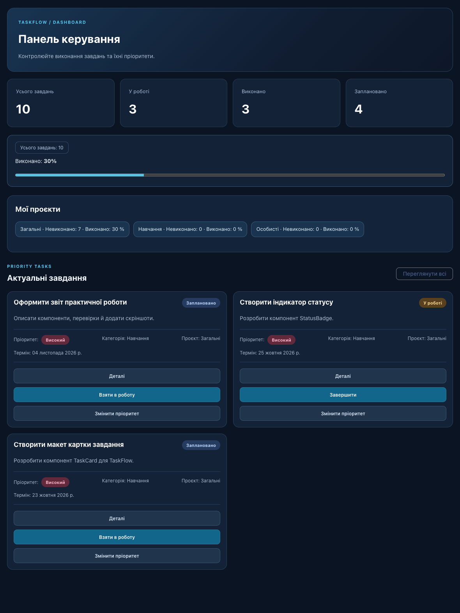
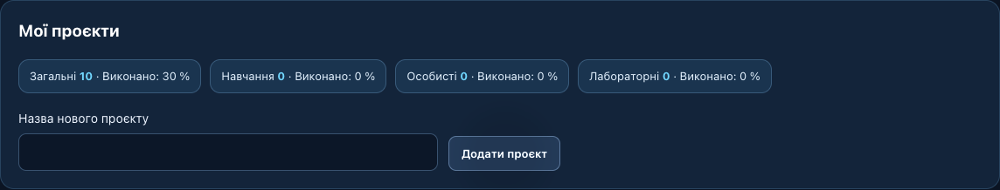
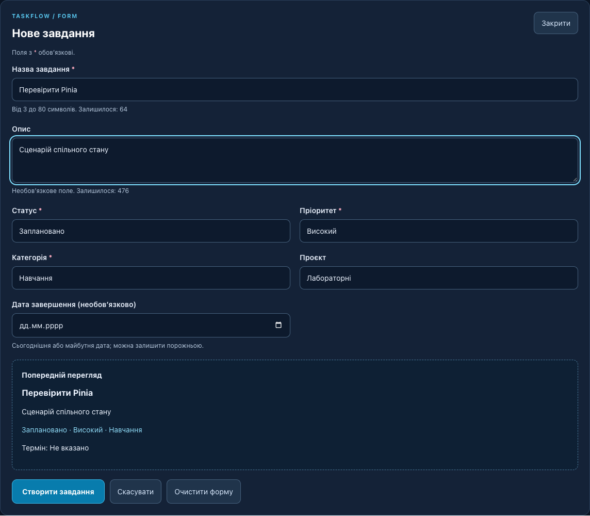
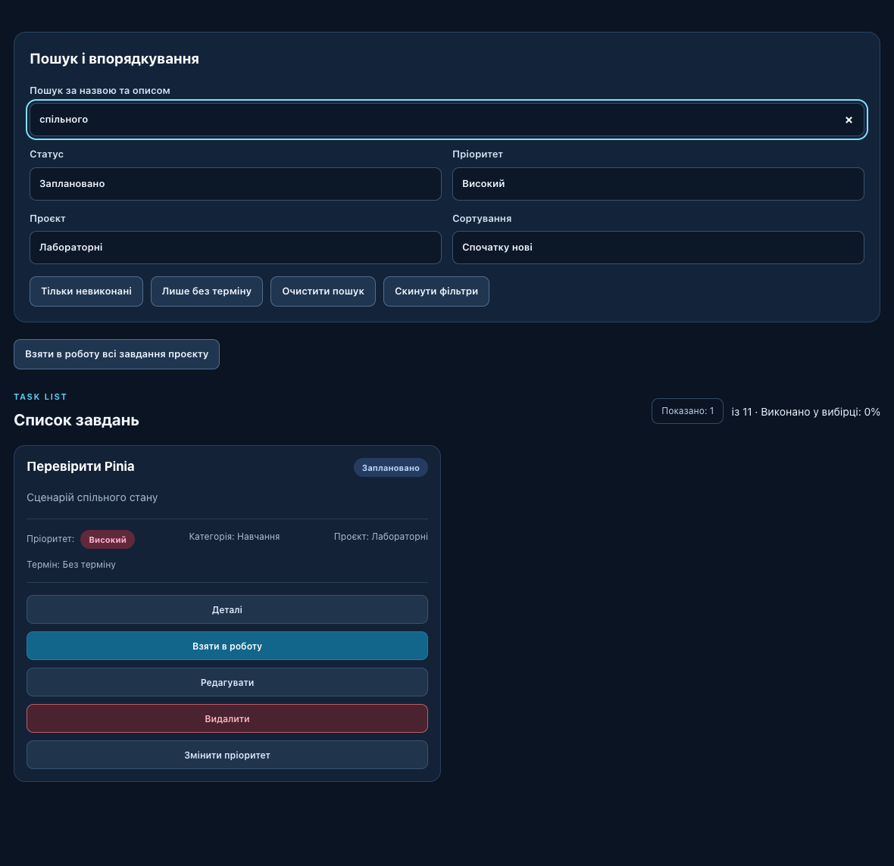
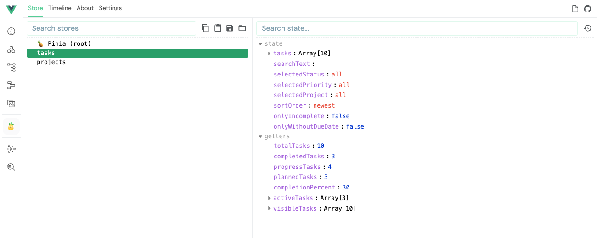
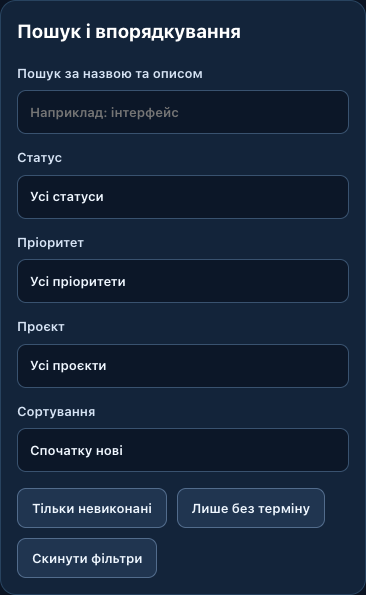
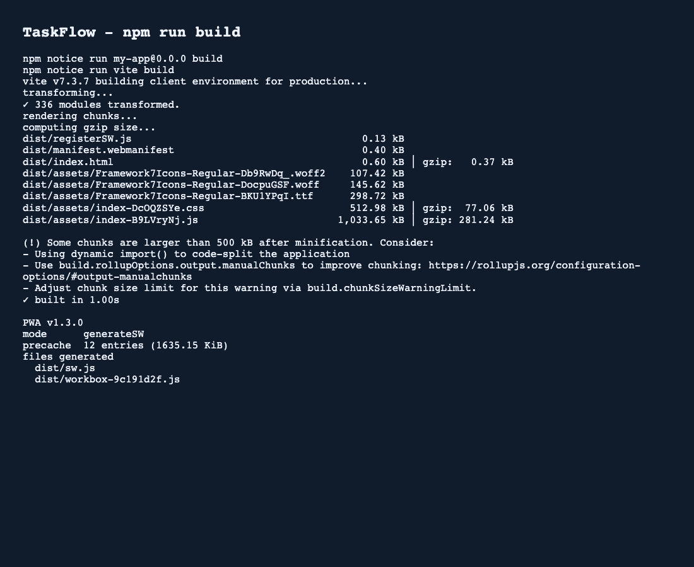

TaskFlow. Централізоване керування станом за допомогою Pinia

Дата виконання: 26.11.2026. Методичні вказівки: 2-9.pdf.

## 1 Тема та мета

Тема: перенесення завдань, проєктів, фільтрів і статистики до сховищ Pinia. Мета: підключити Pinia до Vue 3, застосувати state, getters, actions та storeToRefs(), організувати взаємодію сховищ і синхронне відображення даних на різних сторінках.

## 2 Вихідний стан і результат

Після роботи № 5 TaskFlow містив 10 демонстраційних завдань, CRUD, пошук, комбіновані фільтри, сортування, категорії, форму з валідацією та підтверджене видалення. Попередній стан збережений у Git-коміті 96405a4.

Реалізовано основні вимоги та всі шість додаткових завдань. Перевірено 17 основних пунктів методички, додаткові функції й регресію сортування. Збірка та локальна production-перевірка пройшли. Код надіслано до origin/main у коміті 4392d0f.

Технології: Vue 3, Framework7, Pinia 3, Vite, vite-plugin-pwa; для перевірок використано Google Chrome, Playwright і Vue Devtools.

## 3 Структура проєкту після змін

```js
src/
  main.js                        # підключення Pinia
  store/tasks.js                 # завдання і фільтри
  store/projects.js              # каталог і статистика
  components/TaskForm.vue        # вибір проєкту
  components/TaskListControls.vue # фільтр проєкту
  components/TaskCard.vue        # назва проєкту
  pages/HomePage.vue             # спільна статистика
  pages/TasksPage.vue            # дії та проєкти
  css/task-list.css              # адаптивний блок
```

Це дев’ять файлів із методички. Додатково синхронізовано package.json і package-lock.json, оновлено README, додано сценарій перевірки, матеріали та звіт. App.vue, routes.js, data/tasks.js, базові компоненти й конфігурацію Vite/PWA збережено.

## 4 Принцип роботи спільного стану

Попередній reactive-модуль містив спільний об’єкт і окремі функції. Pinia структурує той самий реактивний стан у stores, додає життєвий цикл екземпляра, підтримку Devtools і явний розподіл відповідальності.

state зберігає tasks, projects і критерії пошуку. getters повертають totalTasks, visibleTasks і projectStats. actions виконують CRUD, перевірку назв та групову зміну статусу. storeToRefs() зберігає реактивність при деструктуризації state/getters. Дії викликаються як методи store.

```js
const taskStore = useTasksStore()
const { tasks, visibleTasks } = storeToRefs(taskStore)
taskStore.setTaskStatus({ id: 10, status: "progress" })
```

## 5 Головна сторінка і статистика



Початкові показники: 10 завдань, 3 у роботі, 3 виконано, 4 заплановано, прогрес 30%. У «Загальних» 7 невиконаних; у порожніх проєктів прогрес дорівнює 0%. Дані не копіюються між сторінками.

## 6 Каталог і прив’язка завдання



Назва проєкту очищується від крайніх пробілів; дозволено 3-40 символів. Повторення без урахування регістру відхиляється.



Форма надсилає projectId через save. Сховище перевіряє існування проєкту; старі записи автоматично отримують general. Редагування зберігає ID завдання.

## 7 Фільтри та групова дія



visibleTasks перевіряє всі умови через логічне І. Фільтри зберігаються при переходах між сторінками. «Лише без терміну» також входить до state й скидається resetFilters().


Escape або «Скасувати» не змінюють завдання. Підтвердження викликає startProjectTasks(projectId); статус усіх завдань цього проєкту стає progress, включно з раніше виконаними.

## 8 Додаткові завдання та Vue Devtools



1. projectStats у сховищі проєктів обчислює total, completed, incomplete і percent за один прохід. Перевага: одна формула для різних сторінок. Недолік: сховище проєктів залежить від tasks-store, що потрібно враховувати в тестах.

2. На HomePage додано назви проєктів і кількість невиконаних завдань без дублювання масиву tasks.

3. Відсоток дорівнює round(completed / total × 100); для total = 0 повертається 0%.

4. Груповий action виконується після окремого підтвердження. 5. Фільтр без терміну поєднується з іншими умовами.

6. У Vue Devtools перевірено обидва stores та результат action setTaskStatus: progressTasks змінився з 3 на 4, plannedTasks - з 4 на 3. Для знімка використано тимчасову dev-конфігурацію без зміни production-конфігурації.

## 9 Перевірки завантаження і проєктів

## 10 Перевірки форми й фільтрації

## 11 Решта перевірок і адаптивність

09-10. Редагування переносить запис до іншого проєкту зі збереженням ID. Зміна статусу на головній одразу відображається в списку й статистиці.

11-12. Скасування видалення залишає 11 записів; підтвердження зменшує кількість до 10. Головна статистика також оновлюється.

13-15. Скидання повертає початкові фільтри. Умови зберігаються між сторінками. Повний reload відновлює 10 завдань і три початкові проєкти.

16-17. npm run build завершується успішно. На ширині 390 px форма й фільтри розташовані в один стовпчик; горизонтального переповнення немає.



Додатково перевірено всі вісім режимів сортування: вибраний режим доходить до Pinia, початковий порядок tasks не змінюється. Виправлено помилкові аргументи emit для update:sort.

## 12 Production збірка та публікація



Створено production bundle, manifest і service worker. У Chrome локально перевірено відкриття обох сторінок, реєстрацію service worker та офлайн-перезавантаження. Runtime-помилок не виявлено. Vite попереджає про пакет понад 500 kB; це не блокує збірку.

Код надіслано в main: 4392d0f. Автоматична перевірка Cloudflare «Workers Builds: cross-platform-development» завершилась успішно: completed / success, версія 70a3dfc1-4e67-4e6d-909f-b5e1226d0f4a. Це підтверджує успіх автоматичного процесу Cloudflare. Публічна адреса сайту не надана, тому відкриття віддаленого застосунку в браузері окремо не перевірене.

Репозиторій: https://github.com/wooxyyy/Cross-platform-development

## 13 Висновки та обмеження

TaskFlow переведено на два централізовані Pinia-сховища зі збереженням попередніх можливостей. Додано каталог проєктів, прив’язку, комбіновану фільтрацію, проєктну статистику й підтверджену групову дію. Переходи між сторінками використовують єдиний стан.

Pinia не забезпечує постійного збереження. Після повного перезавантаження завдання, проєкти й фільтри відновлюються з демонстраційних даних, як передбачено роботою № 6. IndexedDB не додано. Встановлення PWA на фізичному пристрої не перевірялось.

npm ci повідомляє про 12 вразливостей у дереві залежностей: 1 низька, 5 помірних, 6 високих. Масове оновлення залежностей із можливими несумісними змінами не входило до цієї перевірки.

Повні результати: reports/practice6/verification.json, production.json, build.txt, devtools.txt. Автоматизовані сценарії: scripts/verify-practice6.mjs. Усі скріншоти збережено в reports/practice6/screenshots/.

## 14 Контрольні запитання 1 до 7

## 14 Контрольні запитання 8 до 14

## 14 Контрольні запитання 15 до 20


1. **Що називають станом застосунку і навіщо централізувати його керування?** Це поточні дані інтерфейсу. Централізація дає спільне джерело даних і синхронізацію компонентів.

2. **Чим Pinia відрізняється від звичайного reactive-об’єкта?** Pinia структурує стан у сховища зі state, getters, actions, інтеграцією Devtools та екземпляром, прив’язаним до застосунку.

3. **Яка роль createPinia() і де його викликати?** Створює екземпляр менеджера сховищ. У main.js він передається до app.use() перед app.mount().

4. **Чому не можна видаляти registerComponents(app)?** Він реєструє f7-компоненти Framework7. Без реєстрації шаблони не зможуть коректно відобразити ці компоненти.

5. **Яка структура Option Store?** defineStore(id, { state, getters, actions }); state є функцією, яка повертає початкові дані.

6. **Що таке state, getters і actions?** tasks і selectedProject - state; visibleTasks - getter; addTask і deleteTask - actions.

7. **Навіщо storeToRefs()?** Він створює refs для state/getters; звичайна деструктуризація примітивних значень втрачає реактивний зв’язок.

8. **Чим getter відрізняється від action?** Getter обчислює похідні дані без змін вихідного стану. Action виконує операції, змінює стан і може бути асинхронним.

9. **Чому showForm та editingId залишено локальними?** Вони потрібні лише сторінці для керування формою, тому спільне сховище для них зайве.

10. **Як два компоненти користуються одним сховищем?** Обидва викликають useTasksStore() в контексті того самого екземпляра Pinia й отримують спільний store.

11. **Навіщо окреме useProjectsStore()?** Каталог, перевірка назв і статистика проєктів мають окрему відповідальність та можуть повторно використовуватись.

12. **Як перевіряється projectId?** Форма дозволяє вибрати лише наявний проєкт; action додатково перевіряє належність ID до каталогу й застосовує резервний general.

13. **Навіщо старим завданням general?** Це забезпечує зворотну сумісність із демонстраційними записами, які ще не містили projectId.

14. **Чому не сортувати вихідний tasks у getter?** sort() змінює масив на місці. Сортується новий масив після filter(), щоб уникнути побічних змін спільного стану.

15. **Як поєднуються фільтри?** Завдання має задовольняти проєкт, нормалізований текст, статус, пріоритет та обидві швидкі умови одночасно.

16. **Яка схема даних і подій?** Pinia передає дані сторінці, сторінка передає Props у TaskCard; картка генерує Emits, сторінка викликає action сховища.

17. **Чому проєкти зникають після reload?** State зберігається лише в пам’яті. Після нового запуску створюються початкові демонстраційні дані.

18. **Що дасть IndexedDB?** Постійне локальне збереження структурованих завдань і проєктів між сеансами та основу для офлайн-роботи зі змінами.

19. **Що перевіряє npm run build?** Компіляцію Vue, імпорти, production-оптимізацію та PWA-генерацію. Dev-сервер не проходить увесь production-процес.

20. **Як централізований стан допомагає масштабуванню?** Дає спільні правила змін, повторне використання обчислень, керовані залежності й основу для збереження та синхронізації.