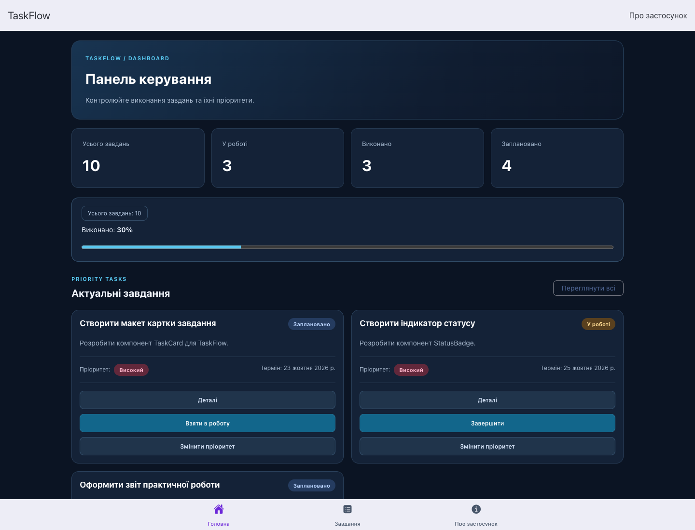
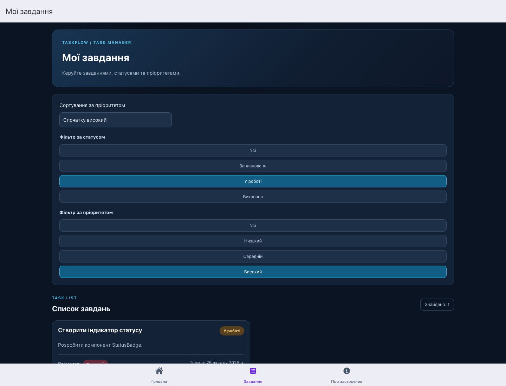
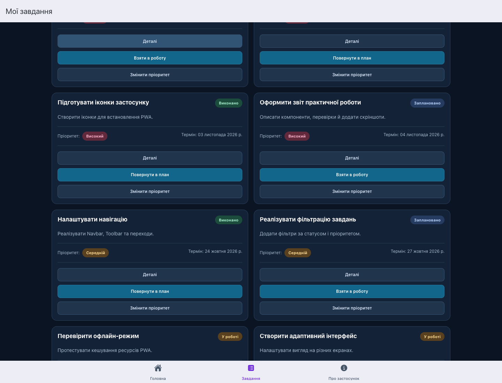
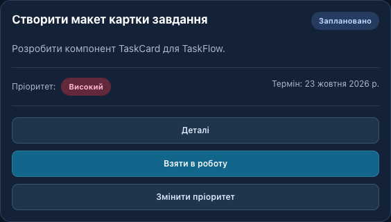
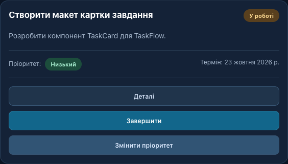

# Звіт: TaskFlow
TaskFlow • Розробка компонентів Vue у PWA-застосунку

Дата виконання: 27.10.2026. Основа: методичні вказівки «2-5.pdf».


## 1. Тема та мета

Тема: картки завдань, індикатори статусу, пріоритети, Props та Emits. Мета: навчитися створювати повторно використовувані компоненти Vue 3, передавати дані через Props, генерувати події Emits та застосовувати реактивність у TaskFlow.


## 2. Теоретичні відомості

Компонент Vue - незалежна частина інтерфейсу у файлі .vue, що поєднує шаблон і логіку. Компонентний підхід дозволяє повторно використовувати інтерфейс і перевіряти його частини окремо.

Props передають дані від батьківського компонента до дочірнього. Дочірній компонент не змінює ці дані: він повідомляє про дію подією Emits, а батьківський обробник оновлює спільне сховище.

ref() зберігає реактивне значення, reactive() створює реактивний об’єкт, computed() обчислює похідні дані. HomePage та TasksPage імпортують один taskState; зміни одразу відображаються на обох сторінках.


## 3. Підсумок перевірки

Усі 8 основних кроків реалізовано: дані, реактивне сховище, обидва індикатори, картка, головна сторінка, фільтри та стилі. Виконано всі 6 додаткових завдань. Виправлено розміщення нижньої навігації через слот #fixed Framework7. Уточнено довідку.

Після додавання 4 власних записів: усього 10, у роботі 3, виконано 3, заплановано 4; відсоток виконання 30%. Значення 6/2/2 у методичці стосуються початкових шести записів.


## 4. Структура та компоненти

```text
src/
  components/
    AppTabbar.vue, TaskCard.vue
    StatusBadge.vue, PriorityBadge.vue
    TaskCounter.vue, TaskSelection.vue
  data/tasks.js
  store/tasks.js
  pages/HomePage.vue, TasksPage.vue
  pages/AboutPage.vue, HelpPage.vue
  css/app.css, task-components.css
  App.vue, main.js, routes.js
reports/ - текст звіту, перевірки та скріншоти
output/pdf/ - готовий PDF-звіт
```

TaskCard відображає назву, опис, статус, пріоритет і термін. Генерує status-change, priority-change та task-select. StatusBadge і PriorityBadge перетворюють значення стану на кольорові текстові індикатори з резервним відображенням невідомих значень.

TaskCounter отримує число через count і підпис через label. TaskSelection відображає вибране батьківською сторінкою завдання; деталі реактивно оновлюються разом зі сховищем.


## 5. Приклади Props та Emits

```vue
// TaskCard.vue
const props = defineProps({
  task: { type: Object, required: true },
})
const emit = defineEmits([
  'status-change', 'priority-change', 'task-select',
])
emit('task-select', { id: props.task.id })

// Батьківська сторінка
<TaskCard :task="task" @task-select="handleTaskSelect" />
function handleTaskSelect({ id }) {
  selectedTaskId.value = id
}
<TaskCounter :count="filteredTasks.length" />
```


## 6. Головна сторінка та статистика

Рис. 1. Чотири показники статистики, TaskCounter та прогрес 30%.



Процент = round(кількість виконаних / загальна кількість × 100). Для порожнього списку повертається 0, а max прогресу залишається додатним. На головній відображаються три актуальні незавершені завдання з найвищим пріоритетом.


## 7. Фільтрація та вибір завдання

Рис. 2. Поєднання фільтрів «У роботі» та «Високий» залишає завдання № 3.



Рис. 3. Обробка task-select: батьківська сторінка показує деталі вибраного запису.



Фільтри застосовуються одночасно. Доступні три порядки: високий пріоритет спочатку, низький спочатку та порядок додавання. Сортування не змінює початковий масив сховища.


## 8. Картка до та після зміни

Рис. 4. Початково: «Заплановано», пріоритет «Високий».



Рис. 5. Після дій: «У роботі», пріоритет «Низький».



Кнопки генерують події з id та новим значенням. Обробники сторінки викликають setTaskStatus / setTaskPriority. Цикли: todo → progress → done → todo; low → medium → high → low. Початкові об’єкти даних не змінюються.


## 9. Додаткові завдання

1. Додано чотири власні завдання (id 7-10): доступність, офлайн-перевірка, іконки й оформлення звіту; використано різні статуси та всі рівні пріоритету.

2. Додано четвертий показник «Заплановано» на computed().

3. Створено TaskCounter.vue із числовим Props count; використано на двох сторінках.

4. Реалізовано процент виконання та семантичний елемент progress.

5. Додано task-select з payload { id }; обидві сторінки обробляють вибір і показують деталі.

6. Реалізовано сортування списку за пріоритетом у двох напрямках і початковий порядок.


## 10. Перевірки та результати

npm run build: успішно, створено production bundle, manifest і service worker. Залишилося попередження Vite про JS-пакет понад 500 kB; воно не блокує збірку.

У Chrome автоматично перевірено 12 сценаріїв: початкова статистика; 10 карток і навігація; поєднані фільтри; зникнення запису після завершення та порожня вибірка; оновлення статистики до 40%; повні цикли статусу/пріоритету; вибір і закриття деталей; обидва напрями сортування; скидання після reload; мобільна ширина 390 px без горизонтального переповнення; About/Help; відсутність runtime-помилок. Результати збережено в reports/verification.json.

Дані зберігаються лише у пам’яті: повне перезавантаження відновлює демонстраційні записи, як передбачено методичкою. Встановлення PWA та офлайн-запуск на фізичному пристрої окремо не перевірялися.


## 11. Висновок

Закріплено створення компонентів Vue 3, односпрямовану передачу даних через Props, події Emits із payload, реактивне спільне сховище, обчислювані фільтри, статистику та сортування. Один TaskCard повторно використовується на головній сторінці й у повному списку.


## 12. Відповіді на контрольні запитання

<b>1. Що таке компонент Vue 3?</b> Незалежний блок шаблону та логіки; дає повторне використання й простіший супровід.

<b>2. Для чого v-for?</b> Для побудови списку елементів або компонентів за масивом.

<b>3. Навіщо :key?</b> Для стабільної ідентифікації елементів під час оновлення або перестановки списку; використано task.id.

<b>4. Що таке Props?</b> Вхідні дані компонента, передані батьківським компонентом.

<b>5. Призначення defineProps()?</b> Оголошує вхідні властивості та їх типи, обов’язковість і типові значення у script setup.

<b>6. Що таке Emits і defineEmits()?</b> Власні події компонента; defineEmits оголошує їх та повертає функцію emit.

<b>7. Чому не слід змінювати Props?</b> Власником стану є батьківський компонент; події роблять зміну стану явною та передбачуваною.

<b>8. ref() і reactive()?</b> ref обгортає значення з доступом через .value у JavaScript; reactive повертає реактивний proxy об’єкта.

<b>9. Призначення computed()?</b> Кешує похідне значення та перераховує його при зміні реактивних залежностей.

<b>10. Як синхронізовано сторінки?</b> Вони імпортують той самий реактивний taskState із store/tasks.js.

<b>11. Як змінюється статус?</b> TaskCard обирає наступний статус, надсилає { id, status }; батько викликає setTaskStatus.

<b>12. Чому індикатори окремі?</b> Щоб повторно використовувати єдині підписи, кольори та резервні значення.

<b>13. Як передати payload?</b> Другим аргументом: emit('status-change', { id: 1, status: 'done' }).

<b>14. Що після перезавантаження?</b> Модуль сховища створюється заново з початкових демонстраційних даних.

<b>15. Як повторно використати TaskCard?</b> Імпортувати компонент, передати :task і підключити обробники трьох подій.
